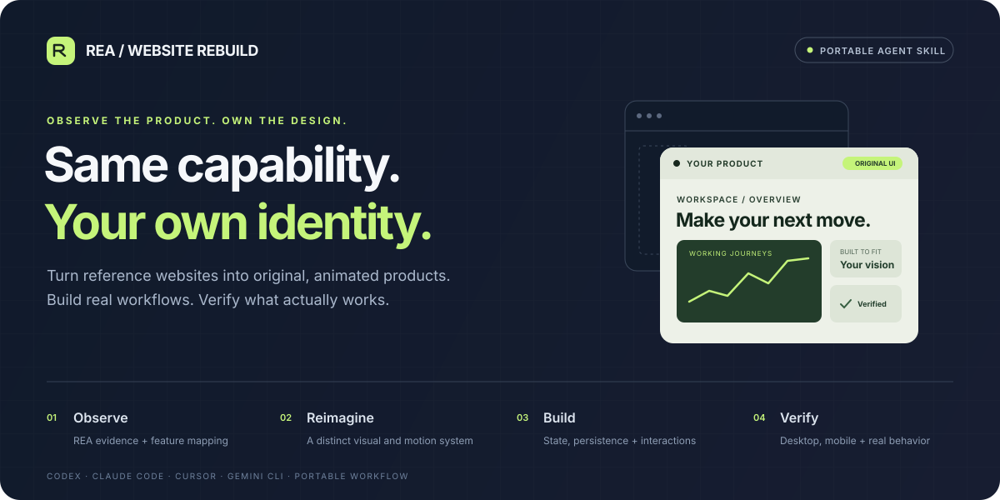
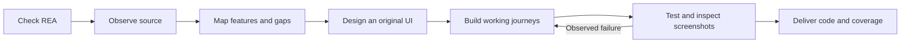

<p align="center">
  
</p>

<p align="center">
  <a href="https://agentskills.io/"></a>
  <a href="https://github.com/morluto/rea"></a>
  <a href="LICENSE"></a>
  <a href="https://github.com/thedileepkumar-dk/REA-Website-Rebuild/releases/latest"></a>
</p>

<p align="center"><strong>Give your coding agent a repeatable way to rebuild a website’s functionality<br/>with a unique, professional, responsive and thoughtfully animated interface.</strong></p>

<p align="center">
  <a href="#install">Install</a> ·
  <a href="#use-it">Use it</a> ·
  <a href="#how-it-works">How it works</a> ·
  <a href="#agent-compatibility">Agent compatibility</a> ·
  <a href="#verification">Verification</a>
</p>

---

## A reference becomes a new product

REA Website Rebuild is an open **Agent Skill** for functional website reconstruction. Your agent inspects accessible pages with [REA](https://github.com/morluto/rea), maps the requested workflows, builds an original application and checks the result in a browser.

The design has its own identity: fresh composition, typography, navigation, components and purposeful motion. The implementation includes working interactions, state, persistence and results. Unavailable services become visibly labelled mocks **when you authorize them**.

| What you get | What the skill asks the agent to deliver |
| :--- | :--- |
| **Evidence before assumptions** | Routes, observed behavior, REA evidence and explicit gaps in source access |
| **An original interface** | A coherent visual direction, responsive layouts, useful animation and reduced-motion support |
| **Working user journeys** | Forms, filters, calculations, saved state, exports and connected pages that do their stated job |
| **Honest service boundaries** | Separate real integrations, local functionality, simulated services and unfinished work |
| **A reviewable handoff** | Launch instructions, a feature ledger, desktop/mobile screenshots and recorded checks |

## Install

### Click-to-run release

<p>
  <a href="https://github.com/thedileepkumar-dk/REA-Website-Rebuild/releases/latest/download/rea-website-rebuild-installer.zip"></a>
</p>

Download and extract the bundle, then open your launcher:

| System | Launcher |
| :--- | :--- |
| **macOS** | Double-click `Install.command` |
| **Windows** | Double-click `Install.cmd` |
| **Linux** | Run `sh install.sh` from the extracted folder |

The launcher handles REA and skill installation together. **Node.js with npm is required**; for a fresh REA install, use Node **22.19+ in the 22 series**, **24.11+ in the 24 series**, or **26+**. Get it from [nodejs.org](https://nodejs.org/). Your OS may request permission to open a downloaded script; the terminal commands below provide another way to run it. A browser download cannot silently install software or load a skill into every agent.

### One command

**macOS / Linux** — automatically detects supported local agent directories:

```sh
curl -fsSL https://raw.githubusercontent.com/thedileepkumar-dk/REA-Website-Rebuild/v1.0.0/install.sh | sh
```

**Windows PowerShell**:

```powershell
iex (irm https://raw.githubusercontent.com/thedileepkumar-dk/REA-Website-Rebuild/v1.0.0/install.ps1)
```

These commands execute this repository’s installer. You can inspect [install.sh](install.sh), [install.ps1](install.ps1) and the [Node installer](scripts/install.mjs) first, or download the bundle and run it locally.

### Choose your agent or preview changes

From an extracted bundle or checkout:

```sh
node scripts/install.mjs --agent codex
node scripts/install.mjs --agent claude
node scripts/install.mjs --agent cursor
node scripts/install.mjs --agent gemini
```

```sh
# Install for more than one agent
node scripts/install.mjs --agent codex --agent claude

# Check prerequisites and print the plan without downloads or writes
node scripts/install.mjs --agent codex --dry-run

# Another agent's documented skill directory; REA CLI is prepared too
node scripts/install.mjs --agent generic --skill-dir /path/to/agent/skills

# Keep MCP configuration untouched and use REA through the CLI
node scripts/install.mjs --agent codex --skip-mcp
```

**Installation order**

1. **Check REA.** Verify a working executable on PATH, in this installer’s runtime, or in the usual Unix user-local bin directory. Reuse it when available.
2. **Install REA if needed.** Install official [`rea-agents@6.7.0`](https://www.npmjs.com/package/rea-agents/v/6.7.0) in `~/.local/share/rea-website-rebuild/runtime` and verify it. No `sudo`, global npm install or shell-profile changes.
3. **Connect selected agents.** Delegate MCP configuration to REA’s official `setup`, scoped to the selected supported clients. `--skip-mcp` and generic mode use the CLI instead.
4. **Install the skill.** Copy the complete folder. Preserve previous versions under `~/.local/share/rea-website-rebuild/backups`, outside skill discovery roots.

An unsuccessful REA install or MCP setup stops before skill copying. REA manages its own config edits/backups; review setup output after a partial failure. With no agent argument, existing Codex, Claude Code, Cursor and Gemini CLI directories are detected; if none exist, the portable skill goes to `~/.agents/skills/`.

Start a fresh agent session after installation. Browser inspection also needs an authorized Chromium/CDP session; follow the [connection guide](skills/rea-website-rebuild/references/rea-inspection.md). Installing REA does not connect a browser automatically.

## Use it

**Codex**

```text
Use $rea-website-rebuild to inspect https://example.com and rebuild its
workflows in ./my-product. Create an original, professional, animated UI.
Implement local persistence. Mock unavailable external services and label
them clearly. Verify desktop and mobile journeys, compare screenshots,
and report the remaining gaps.
```

**Claude Code** — use `/rea-website-rebuild` followed by the same request.

**Any coding agent with file access** — tell it:

```text
Read /path/to/rea-website-rebuild/SKILL.md and follow its references.
Use REA to inspect https://example.com and rebuild the requested workflows
in ./my-product with a distinct, professional, animated interface.
```

Adjust the source, output directory, feature scope and mock policy to your project. You can specify an existing framework, brand, backend or preferred browser.

## How it works



The agent records source observations separately from marketing claims and inferred behavior. It creates a feature contract, builds complete vertical slices and checks rendered outcomes, persistent state and cross-page consistency. Screenshot comparisons assess workflow coverage and intentional design differences.

Private pages require an authorized session. Inaccessible business rules and backends remain explicit gaps. The skill can guide a full implementation of the **agreed, observable scope**; a URL alone cannot reveal every private feature or guarantee a production-ready clone.

## Agent compatibility

| Agent | Installation | REA access |
| :--- | :--- | :--- |
| **Codex** | Automatic folder install; optional UI metadata | Official REA MCP setup or CLI |
| **Claude Code** | Automatic personal skill install | Official REA MCP setup or CLI |
| **Cursor** | Automatic personal skill install | Official REA MCP setup or CLI |
| **Gemini CLI** | Automatic shared skill install | Official REA MCP setup or CLI |
| **Other Agent Skills hosts** | `--agent generic --skill-dir …` | CLI, or configure the host using REA’s guide |
| **Agents without skill discovery** | Read the entire skill folder through `SKILL.md` | CLI or a working MCP connection |

The workflow is vendor-neutral. Execution requires an agent that can read files, write/run code and operate a browser. Host permissions and remote environments still apply. Automated setup supports the four named local clients; it does not claim every agent supports local scripts or MCP. See [portability](skills/rea-website-rebuild/references/portability.md) for paths and environment overrides.

## Verification

The optional Python helpers create and audit a small project ledger:

```sh
python3 /path/to/rea-website-rebuild/scripts/init_rebuild.py \
  --output ./my-product --source-url https://example.com

python3 /path/to/rea-website-rebuild/scripts/audit_rebuild.py \
  --project ./my-product --profile demo
```

The `production` profile rejects mocks. An audit checks **recorded coverage and artifact existence**; it does not prove the tests ran or certify production readiness. The agent must inspect actual runtime behavior and screenshots.

Maintainer checks, with no third-party test dependencies:

```sh
npm test
python3 skills/rea-website-rebuild/scripts/test_helpers.py
```

See [TESTING.md](TESTING.md) for tested environments, scenarios and limits.

<details>
<summary><strong>Package contents</strong></summary>

```text
REA-Website-Rebuild/
├── README.md
├── Install.command / Install.cmd
├── install.sh / install.ps1
├── scripts/install.mjs
├── tests/installer.test.mjs
└── skills/rea-website-rebuild/
    ├── SKILL.md
    ├── agents/openai.yaml
    ├── references/
    │   ├── design-and-motion.md
    │   ├── feature-contract.md
    │   ├── portability.md
    │   ├── rea-inspection.md
    │   └── verification.md
    └── scripts/
        ├── ensure-rea.mjs
        ├── init_rebuild.py
        ├── audit_rebuild.py
        └── test_helpers.py
```

If you copy only the skill folder, its first-use instructions check REA and run `ensure-rea.mjs --install` when missing. MCP registration is separate from this prerequisite helper. Copy the references and scripts with `SKILL.md`.

</details>

## Credits and license

Built on the [Agent Skills format](https://agentskills.io/) and [REA by morluto](https://github.com/morluto/rea). This workflow is independently maintained and is not an official REA or agent-vendor product. REA remains a separate dependency under its own license.

[MIT licensed](LICENSE). Created by [Dileep Kumar](https://github.com/thedileepkumar-dk).
